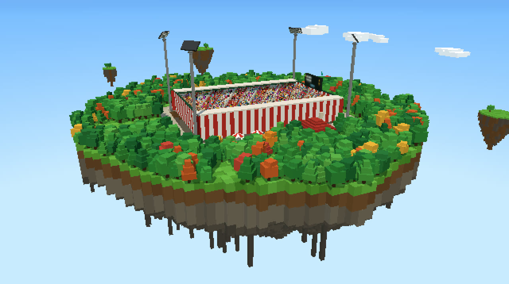
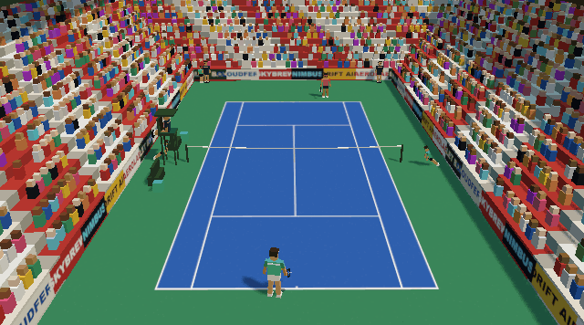
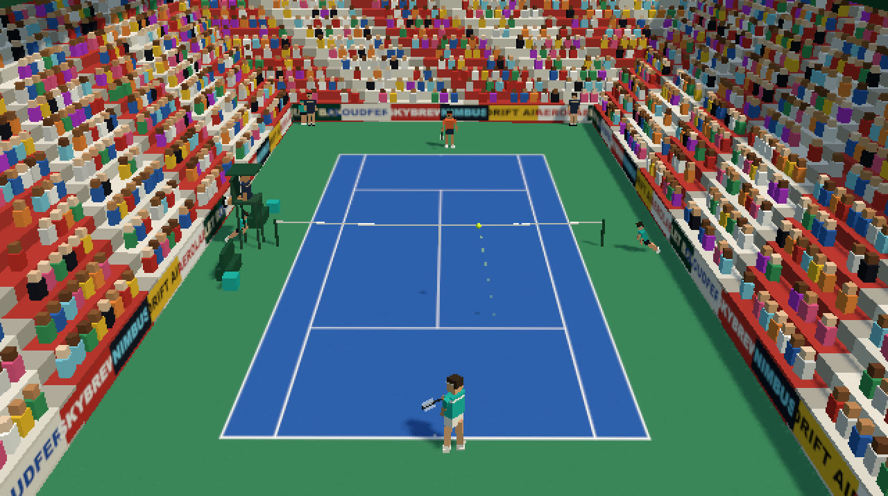
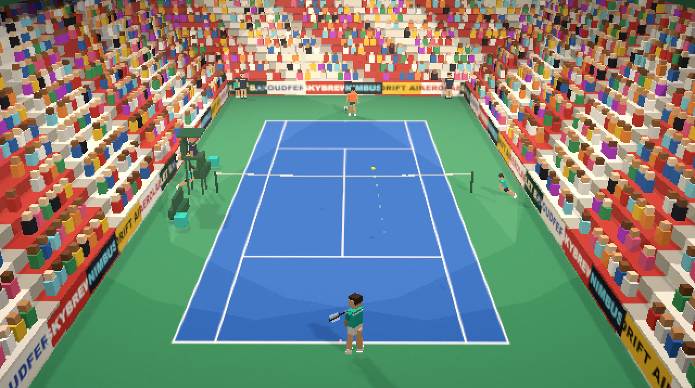
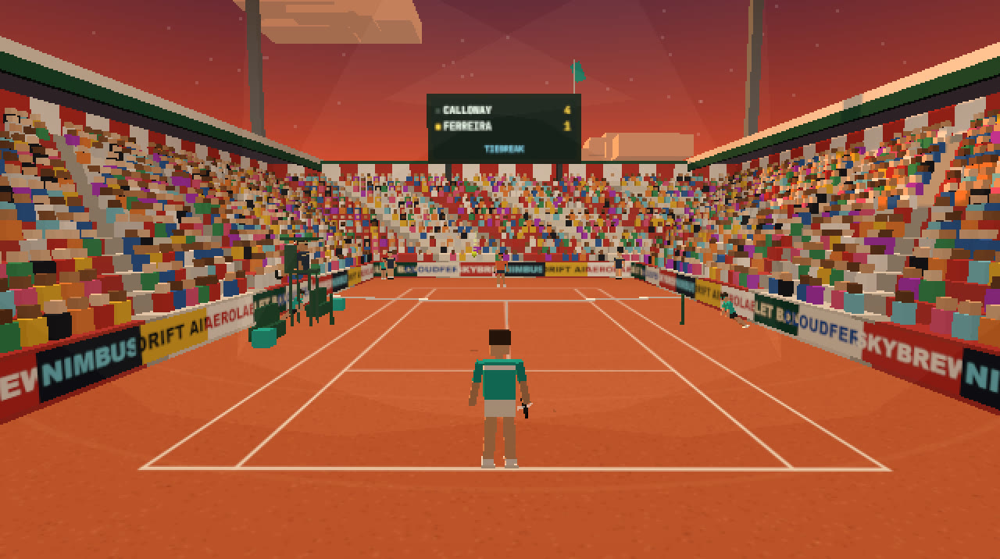
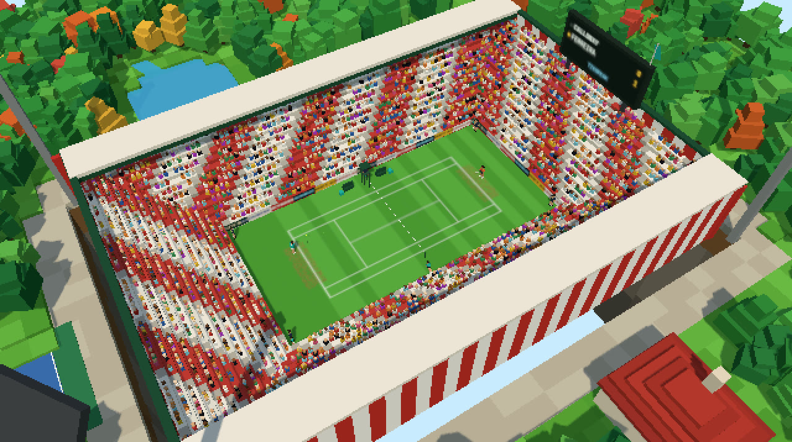
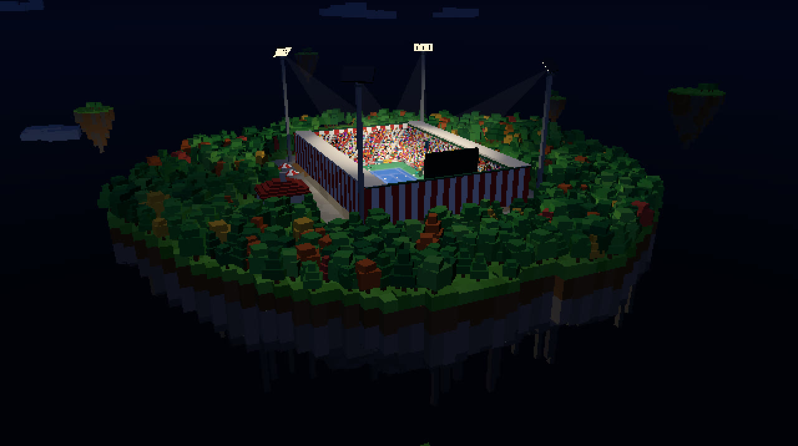
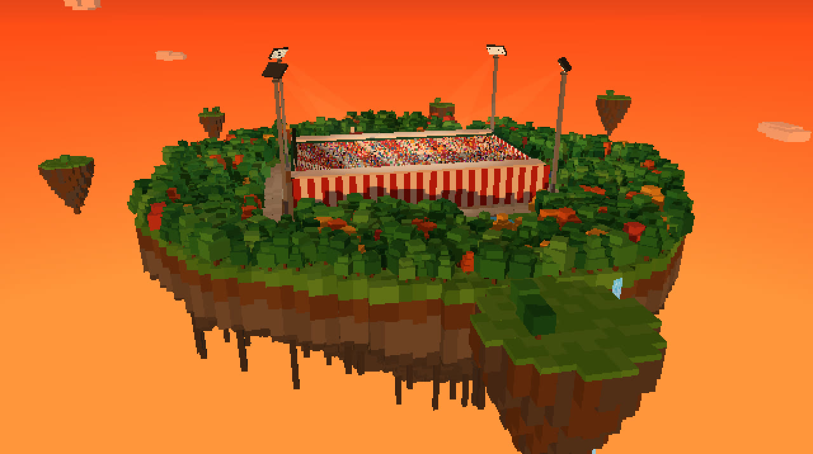
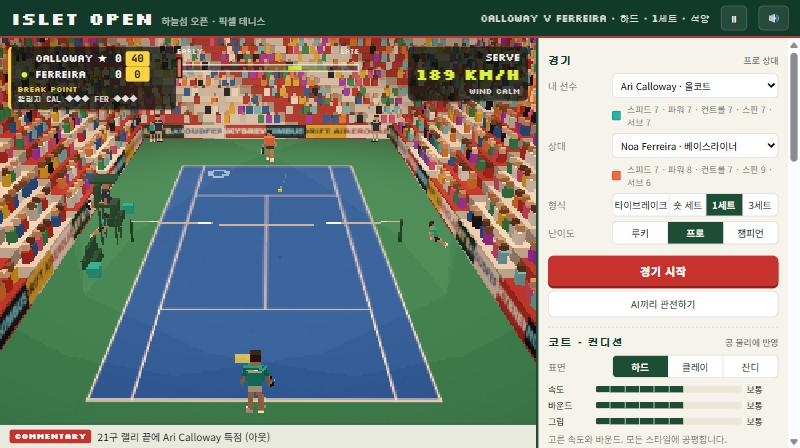
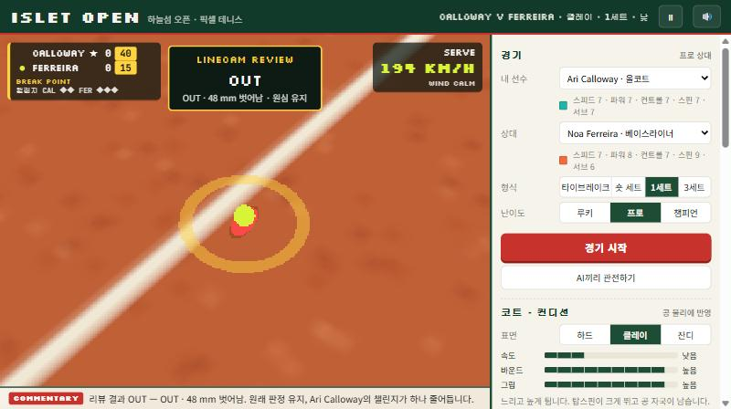

<div align="center">



# 하늘섬 오픈 · Islet Open

**구름 위에 떠 있는 섬의 센터 코트에서 치는, 브라우저 3D 픽셀아트 테니스**

타이밍 샷 · 하드/클레이/잔디 공 물리 · 라인 판정 챌린지 · 낮·석양·조명탑 밤 · 설치·빌드 없음

<p>
  <a href="https://jeiel85.github.io/islet-open/"></a>
</p>
<p>
  
  
  
  
  <a href="https://github.com/jeiel85/islet-open/actions/workflows/test.yml"></a>
</p>



</div>

---

## 어떤 게임인가요

떠 있는 섬 위 복셀 경기장이라는 아이디어를 테니스로 옮긴 오리지널 게임입니다. 숲으로 덮인 섬 한가운데 붉은 줄무늬 센터 코트가 있고, 2,500여 명의 블록 관중이 랠리마다 들썩입니다. 섬 둘레로는 작은 섬들이 떠다니고 연못 물은 섬 가장자리에서 폭포가 되어 떨어집니다.

핵심은 **타이밍**입니다. 공이 몸 앞의 타점에 오는 순간 샷 키를 누르면 됩니다. 빠르면 공이 당겨지고 늦으면 밀려서 사이드라인 밖으로 나가기도 합니다. 공은 직접 만든 물리로 날아갑니다. 공기 저항과 스핀(마그누스 효과)이 궤적을 휘게 하고, 바운드할 때는 코트 표면과의 마찰이 속도와 스핀을 바꿉니다. 그래서 같은 탑스핀도 클레이에서는 높이 튀고 잔디에서는 낮게 미끄러집니다.

라인 근처에 떨어진 공은 선심이 가끔 잘못 판정합니다. 억울하면 **챌린지**하세요. 카메라가 공 자국으로 내려가서 몇 mm 차이였는지 보여 줍니다.

## 갤러리

| | |
|---|---|
|  |  |
|  |  |
|  |  |

<p align="center"></p>
<p align="center"></p>

## 특징

- **타이밍 샷**: 이상적인 타점(몸 앞 45 cm) 기준 ±35 ms면 PERFECT, ±160 ms까지 칠 수 있습니다. 포핸드를 빨리 치면 왼쪽으로 당겨지고 늦게 치면 오른쪽으로 밀립니다(백핸드는 반대). 손이 닿을락 말락 한 공, 너무 낮거나 몸에 붙은 공은 품질이 떨어집니다.
- **공 물리**: 57 g 공의 공기 저항, 스핀에 따른 마그누스 양력, 바람. 바운드는 반발계수와 접촉면 마찰로 계산하고, 미끄러짐이 멈추면 구름 상태로 넘어갑니다. 탑스핀은 바운드 뒤에도 속도를 유지하며 튀어 오르고, 슬라이스는 깔리면서 속도가 죽습니다. 네트 테이프에 걸리면 넘어가기도 하고 떨어지기도 합니다.
- **샷 솔버**: 목표 지점과 네트 위 통과 높이를 정하면, 저항·스핀·바람을 반영한 발사 속도를 이분 탐색으로 찾습니다. 선수의 최대 속도를 넘으면 더 높은 궤적으로 바꿔 칩니다. 사람과 AI가 같은 솔버를 씁니다.
- **코트 표면 세 가지**: 하드(고른 바운드), 클레이(느리고 높게, 공 자국이 남음), 잔디(빠르고 낮게, 베이스라인 마모 정도 조절).
- **라인 판정과 챌린지**: 공 자국이 라인에 닿으면 IN입니다. 선심은 4 cm 이내 공을 가끔 잘못 봅니다. 세트당 챌린지 3개(타이브레이크에서 +1)이고, 성공하면 개수가 줄지 않습니다. IN 판정에 플레이를 멈추고 챌린지했다가 틀리면 포인트를 잃습니다. AI도 자기에게 불리한 판정에 챌린지합니다.
- **AI 상대**: 루키·프로·챔피언 3단계. 공 궤적을 예측해 위치를 잡고(반응 지연·위치 오차 있음), 상황(공격·수비·네트 앞·패싱)에 맞는 샷을 고르며, 아웃될 공은 그냥 보냅니다. 레벨마다 실수율과 서브 폴트율이 다릅니다.
- **선수 6명**: 올코트·베이스라이너·카운터펀처·빅서버·서브 앤 발리·샷메이커. 스피드·파워·컨트롤·스핀·서브·리치 능력치가 실제 플레이에 반영됩니다.
- **경기 형식**: 타이브레이크(7점) · 숏 세트(4게임) · 1세트 · 3세트. 듀스/어드밴티지, 6-6 타이브레이크, 세컨드 서브, 렛, 브레이크·세트·매치 포인트 표시까지 들어 있습니다.
- **코치 작전**: 자동/수동 이동, 기본 서브 코스(와이드·바디·T), 랠리 방향(중앙·크로스·빈 곳), 리스크(라인과의 여유), 네트 대시 빈도.
- **시간과 날씨**: 낮·석양·밤. 밤에는 조명탑 네 개가 켜지고 빛기둥이 보입니다. 바람(무풍·산들바람·돌풍)은 공을 흘리고, 스코어보드 위 깃발로 바람 방향을 볼 수 있습니다.
- **연출**: 중계·후방·공중 카메라, 픽셀 크기 1–4×, 랠리 길이에 따라 커지는 관중 박수와 점프, 아웃 콜을 하는 선심, 3D 스코어보드, 실시간 해설 자막, 심판 음성 콜(브라우저 음성 합성).
- **소리도 코드로**: 타구음·바운드·네트·박수·웅성거림을 Web Audio로 합성합니다. 오디오 파일이 없습니다.
- **어디서나**: 키보드, 게임패드, 휴대폰 터치(조이스틱 + 샷 버튼). 설정은 브라우저에 저장됩니다.

## 조작법

| 동작 | 키보드 | 게임패드 | 터치 |
|---|---|---|---|
| 이동(수동 모드) · 조준 | `WASD` / `←↑↓→` | 왼쪽 스틱 / 십자키 | 조이스틱 |
| 탑스핀 · 플랫 서브 | `J` / `Space` | A | **탑스핀** |
| 슬라이스 · 슬라이스 서브 | `K` | B | **슬라이스** |
| 로브 · 킥 서브 | `L` | Y | **로브** |
| 플랫 강타 | `I` | X | **플랫** |
| 드롭샷 | `U` / `Shift`+`K` | RB | — |
| 챌린지 | `C` | LB | 챌린지 버튼 |
| 카메라 · 소리 · 일시 정지 · 설정 패널 | `V` · `M` · `Esc` · `H` | Back · — · Start · — | 상단 버튼 |

> **서브** — 샷 키로 토스하고, 공이 정점을 지나 내려오기 시작할 때 다시 누릅니다. 좌우 방향키로 코스(와이드/T)를 고르고, 누르지 않으면 코치 작전의 기본 코스로 갑니다.
>
> **랠리** — 상단 타이밍 미터의 커서가 노란 칸에 들어올 때 누르세요. 좌우 방향키를 누른 채 치면 그쪽 사이드라인을, 위/아래를 누르면 깊게/짧게 노립니다. 노란 마름모는 상대 공이 떨어질 곳, 흰 링은 지금 치면 공이 갈 곳입니다.

## 코트 표면

| 표면 | 반발 | 마찰 | 느낌 |
|---|---|---|---|
| 하드 | 0.76 | 0.48 | 고른 속도와 바운드 |
| 클레이 | 0.81 | 0.72 | 느리고 높게 튐 · 탑스핀이 크게 뜀 · 공 자국 |
| 잔디 | 0.69 | 0.30 | 빠르고 낮게 깔림 · 슬라이스가 미끄러짐 · 베이스라인 마모(슬라이더) |

## 규칙에서 단순화한 것

- 체인지오버 때 코트를 바꾸지 않습니다. 플레이어는 늘 화면 앞쪽 코트에서 칩니다.
- 단식만 있습니다. 풋 폴트와 시간 위반은 없습니다.
- 판정이 OUT에서 IN으로 번복되면, 상대가 공에 닿을 수 없는 거리였을 때는 포인트를 주고 그렇지 않으면 포인트(서브)를 다시 합니다.

## 실행과 테스트

빌드가 없습니다. 정적 파일 서버로 열면 됩니다(ES 모듈이라 `file://`로는 열리지 않습니다).

```bash
python -m http.server 8000
```

브라우저에서 `http://localhost:8000`을 엽니다. three.js는 CDN(jsDelivr)에서 import map으로 불러옵니다.

테스트는 Node 22 이상의 내장 테스트 러너를 씁니다.

```bash
node --test
```

점수 규칙(듀스·타이브레이크 서브 순서·세트 종료), 공 물리(스핀·표면·네트), 샷 솔버 정확도(목표 지점 10 cm 이내, 측풍 보정), 라인 판정과 서비스 박스, AI끼리 세 표면에서 끝까지 치르는 경기, 타이밍을 잘 맞추는 사람 입력 봇, 챌린지 처리를 검사합니다.

## 구조

```
index.html        레이아웃 · HUD · 설정 패널 · import map
src/
  config.js       코트 규격(ITF) · 표면 · 바람 · 선수 6명 · 경기 형식 · AI 레벨
  physics.js      공 비행(저항·마그누스·바람) · 바운드 마찰 · 네트 · 궤적 예측
  shots.js        샷 솔버(네트 높이 + 목표 지점) · 샷/서브 레시피
  scoring.js      포인트·게임·세트·타이브레이크 상태 기계
  linecall.js     코트/서비스 박스 판정 · 선심 오판 · 리뷰 문구
  ai.js           요격 위치 계획 · 회복 위치 · AI 샷/서브 선택
  game.js         경기 진행: 서브·랠리·판정·챌린지·통계 (렌더링 없음)
  world.js        떠 있는 섬 · 숲 · 폭포 · 작은 섬 · 구름 · 하늘 · 시간대 조명
  stadium.js      코트 텍스처 · 네트 · 관중석과 관중 · 조명탑 · 스코어보드 · 심판
  players.js      복셀 선수 모델과 스윙·서브·세리머니 동작
  main.js         렌더 루프 · 카메라 · 이벤트 → 소리/해설/HUD 연결
  hud.js · input.js · audio.js · voxel.js
tests/            node --test
```

## 라이선스

[MIT](LICENSE) · 모든 그래픽과 소리는 코드로 생성합니다. 선수·스폰서 이름은 모두 가상입니다.
